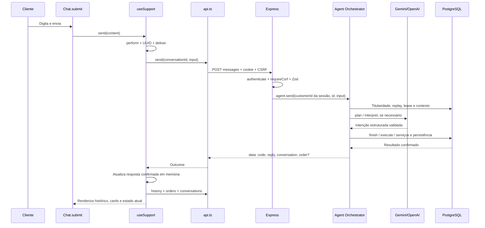

# Guia de estudo — Etapa 4

Este guia acompanha o código efetivamente implementado. Comece com o frontend e siga uma requisição até os módulos existentes do backend. O objetivo é localizar responsabilidades e compreender por que a interface não decide regras críticas.

## Ordem recomendada de leitura

1. `apps/web/src/main.tsx`: o React monta `App` dentro de StrictMode. Em desenvolvimento, efeitos de montagem podem executar novamente para revelar problemas; as escritas ficam em handlers explícitos, não no efeito de inicialização.
2. `apps/web/src/types.ts`: leia Session, Order, Conversation, History, SendMessage e Outcome. São os formatos HTTP usados pela interface; não substituem validação e autorização do backend.
3. `apps/web/src/services/api.ts`: entenda `createApi`, `request`, `all`, `history` e `decisionMessage` antes de ler os componentes.
4. `apps/web/src/hooks/useSupport.ts`: acompanhe `boot`, `perform`, `deliver`, `askOrder`, `decide` e `clear`.
5. `apps/web/src/App.tsx`: observe a escolha entre inicialização, erro, cadastro e aplicação autenticada; depois a seleção entre chat, pedidos e conversas.
6. Componentes Registration, Navigation, Conversations, Orders, Chat e ExternalProducts.
7. `apps/web/src/styles.css`: tokens, estruturas desktop e regras mobile. Compare o DOM de cada componente com sua classe CSS.
8. Testes em services, hooks e components; finalize com os controllers e o orquestrador do backend.

## Mapa dos arquivos

Todos os caminhos abaixo são relativos à raiz do projeto.

| Caminho | Responsabilidade e funções principais | Quem utiliza / dependências chamadas |
| --- | --- | --- |
| apps/web/src/main.tsx | Entrada React, createRoot e StrictMode; preservada | Importa App e CSS |
| apps/web/src/App.tsx | App escolhe seção e compõe layout; openOrder seleciona pedido | Usa useSupport, Navigation, ContextPanel, Chat, Orders, ConversationsPage, Registration |
| apps/web/src/types.ts | Contratos TS de cliente, pedido, turno, resultado e confirmação | Usado pelo HTTP, hook e componentes; não faz I/O |
| apps/web/src/services/api.ts | createApi cria cliente; request controla cookie, CSRF, prazo e erro; all percorre listas; history reúne turnos; decisionMessage encapsula protocolo | Chamado por useSupport; utiliza fetch nativo |
| apps/web/src/hooks/useSupport.ts | useSupport mantém estado compartilhado; boot restaura sessão; perform serializa ações; deliver envia e sincroniza; loadLists/loadHistory leem; newConversation cria contexto; clear remove dados locais | Usado por App; chama somente o cliente SupportApi |
| apps/web/src/components/Registration.tsx | Registration e submit: apresentação, campos, validação HTML e envio | App fornece callback register; componente não acessa cookie ou provedor |
| apps/web/src/components/Navigation.tsx | Navigation e tipo Section: perfil, seção ativa, saída e navegação mobile | App fornece estado/callbacks; usa Brand/Icon |
| apps/web/src/components/Conversations.tsx | conversationTitle deriva título; ConversationList, ContextPanel e ConversationsPage apresentam listas e prévias | Usa SupportState, OrderSummary e callbacks de seleção; nenhum fetch próprio |
| apps/web/src/components/Chat.tsx | Chat controla rascunho e scroll; submit envia; ConfirmationPanel apresenta desafio; displayMessage adapta instruções técnicas para os botões | Chama send/decide/handoff/retrySend do hook; usa OrderCard e ExternalProducts |
| apps/web/src/components/Orders.tsx | Orders busca/filtra localmente e seleciona; OrderDetails apresenta dados oficiais; OrderCard mostra snapshot de uma resposta | Usa tipos de pedido e callbacks; onAsk leva ao agente, nunca ao cancelamento REST |
| apps/web/src/components/ExternalProducts.tsx | ExternalProducts apresenta catálogo; safeCatalogImage restringe imagens HTTPS ao domínio conhecido | Chat fornece products do resultado; imagem opcional vem de fakestoreapi.com |
| apps/web/src/components/ui.tsx | Brand/Icon, Status, OrderSummary, ProductPlaceholder, ErrorBanner, EmptyState e formatadores money/date/time/shortId | Componentes reutilizam estes elementos; sem chamadas HTTP |
| apps/web/src/styles.css | Paleta, estados, tipografia, grids, cartões, chat e media queries | Importado pela entrada; sem dependência CSS externa |
| apps/web/index.html | Documento pt-BR, viewport, descrição e título | Entrada do Vite/Nginx |
| apps/web/package.json | Scripts e dependências de desenvolvimento de testes | React/ReactDOM continuam as únicas dependências de execução |
| package.json | npm test executa os testes dos dois workspaces | Mantém comandos existentes de integração, build e typecheck |
| package-lock.json | Fixa a instalação reproduzível, incluindo dependências de teste | npm ci |

Não há classes React. `ApiError` é a classe de erro da integração HTTP; os componentes são funções e `useSupport` é um custom hook.

## O estado, na prática

Há três categorias de estado:

- **Interface local:** rascunho em Chat; busca/filtro/visualização de detalhe em Orders; seção/pedido selecionado em App.
- **Cópia de dados do servidor:** session, orders, conversations e histories no hook. `histories` é um mapa por conversationId; selecionar outra conversa não mistura mensagens entre IDs.
- **Controle de operações:** busy informa a ação em andamento; locked é uma ref síncrona que bloqueia eventos concorrentes antes do próximo render; retry guarda a entrada exata de um envio incerto; sending é só a apresentação temporária do envio.

O estado pendingConfirmation vem do backend. O frontend não gera desafio, não estende validade e não autoriza cancelamento. `outcomes` mantém cards estruturados por clientMessageId durante a sessão React; o histórico HTTP contém apenas mensagens e estado atual, portanto cards não reaparecem artificialmente após reload.

Por que uma ref para locked? Duas chamadas de evento podem ocorrer antes de o React aplicar `setBusy`. A ref muda imediatamente. Já busy é estado porque sua alteração precisa redesenhar botões e indicadores.

## Fluxo completo de uma mensagem

Os nomes no backend são `createConversationRouter` em `conversation.routes.ts`, `authenticate` e `requireCsrf` em `session.middleware.ts`, `createConversationController(...).send`, `sendMessageSchema`, `createAgentOrchestrator(...).send`, `plan` e `execute`. A execução utiliza o mesmo módulo orders da API principal. Consulte o guia da Etapa 3 para os detalhes transacionais.

O React não chama a OpenAI/Gemini diretamente. A mensagem passa por uma chamada autenticada à nossa API; o backend escolhe o provedor configurado.

## Cinco fluxos para seguir no depurador

### 1. Cadastro e restauração

`Registration.submit` → `useSupport.register` → `client.register` → `request('/customers', 'POST', ...)` → `customer.controller.ts` → serviço/repository existentes.

O navegador guarda Set-Cookie automaticamente; JavaScript recebe cliente e CSRF. O hook chama setCsrf e loadLists. Ao recarregar, `boot` começa em `client.current`; uma resposta 401 significa ausência de sessão, enquanto uma falha técnica mostra tela de erro e não cria um novo cadastro silenciosamente.

### 2. Consulta de pedido

`Orders` → `OrderDetails.onAsk(false)` → callback de App troca para chat → `useSupport.askOrder(id, false)` → `newConversation` → `deliver` com UUID completo do pedido.

O backend interpreta a solicitação e consulta `orders.getOwn`. A UI apresenta o texto real e o OrderCard retornado. O número curto é só apresentação: o ID completo continua disponível no detalhe e é usado na integração.

### 3. Solicitação e confirmação de cancelamento

`OrderDetails.onAsk(true)` → `askOrder` → mensagem “Quero cancelar o pedido UUID” → backend responde CONFIRMATION_REQUIRED e pendingConfirmation → `ConfirmationPanel`.

Cliente clica Cancelar pedido → `useSupport.decide(true)` → `decisionMessage` → `deliver`. O corpo tem frase exata e confirmationId separado. O backend pula inferência nesse protocolo, verifica o desafio e chama o serviço determinístico de pedidos. Só após resposta confirmada o hook atualiza estado e listas. Manter pedido usa o mesmo caminho com `decide(false)` e DESISTIR.

O botão não chama o endpoint REST de cancelamento. Ocultar um botão por status melhora a experiência; nunca substitui a verificação de status no servidor.

### 4. Produtos externos

Mensagem pedindo produtos → `send` → backend `plan` interpreta ORDER_PRODUCTS e consulta o pedido próprio → `products.getProduct` chama Fake Store com timeout/validação → `execute` combina informações complementares com os dados oficiais → `ExternalProducts`.

Título, descrição e categoria são texto; a imagem precisa passar por `safeCatalogImage`. Preços externos não entram no total. Catálogo indisponível não apaga os dados oficiais do pedido.

### 5. Atendimento humano

Botão Falar com atendente → `useSupport.handoff` → cria conversa se necessário → `client.handoff` → POST /handoffs → aviso de simulação e atualização da conversa.

Esse atalho é uma solicitação explícita ao endpoint existente e dispensa interpretação da IA. Pedir atendente por mensagem também continua passando pelo agente. Nenhum dos caminhos promete contato real.

## Como os arquivos se dividem

- **Componente:** apresenta dados e recebe interações. Não deve fazer autorização.
- **Hook:** coordena estado e casos de uso da interface. Pode impedir envio concorrente, mas não decide se um pedido é cancelável no banco.
- **Serviço HTTP:** conhece URLs, verbos, headers, prazo e envelopes. Isola detalhes do protocolo de confirmação.
- **Tipos TS:** ajudam o editor a conferir os formatos; não são validação de segurança em runtime.
- **DTOs/Zod do backend:** validam entradas reais recebidas por HTTP.
- **Middleware do backend:** verifica sessão, CSRF e demais proteções antes do controller.
- **Controller:** transforma HTTP em chamada de serviço com identidade obtida da sessão.
- **Orchestrator:** coordena interpretação, estados conversacionais e chamadas dos serviços.
- **Service de negócio:** contém regras determinísticas de pedidos/encaminhamento.
- **Repository/Prisma:** consulta e persiste dados, garantindo constraints/transações existentes.
- **Integração externa:** comunica com Gemini/OpenAI/Fake Store; não autoriza operações por si só.

## Depuração no VS Code

Use desenvolvimento local para inspecionar código-fonte com recarga. Libere as portas usadas pelo Docker web/API antes de iniciar os equivalentes locais, mantendo o PostgreSQL e seu volume.

1. Execute API e web com os comandos de desenvolvimento existentes.
2. No VS Code, use **Debug: Open Link** com http://localhost:5173 ou a configuração de depuração de navegador disponível no seu ambiente. O debugger JavaScript do VS Code reconhece os módulos do Vite.
3. Para a API, use um JavaScript Debug Terminal e execute `npm run dev -w @support/api`. Não imprima o ambiente nem tokens para diagnosticar.
4. Em Network, filtre `/conversations` ou `/orders`. Observe método, status e duração. Evite compartilhar headers/cookies, CSRF, payloads com dados pessoais ou chaves.

Breakpoints úteis:

| Arquivo/função | O que observar |
| --- | --- |
| Registration.tsx / submit | Nome/e-mail demonstrativos e validação antes do callback |
| api.ts / request, antes de fetch | Path, método e presença dos campos esperados, sem expor segredos |
| useSupport.ts / boot | Se é visitante (401) ou falha técnica |
| useSupport.ts / perform | locked/busy e serialização |
| useSupport.ts / deliver | Mesmo clientMessageId no retry; resultado confirmado antes dos GETs |
| useSupport.ts / askOrder | Criação de contexto e UUID completo do pedido |
| useSupport.ts / decide | Desafio da conversa atual e mensagem exata |
| Chat.tsx / ConfirmationPanel | pendingConfirmation e cálculo visual de expiração |
| Chat.tsx / submit e efeitos de scroll | Rascunho, Enter/Shift+Enter, nearBottom e troca de conversa |
| Orders.tsx / filtered | Busca/filtro local, sem requests adicionais |
| conversation.controller.ts / send | DTO Zod e customerId obtido da sessão |
| agent.orchestrator.ts / plan e execute | Interpretação separada da operação determinística |
| order.service.ts / cancel | Revalidação e resultado real da operação |

Exemplo de investigação: se o agente respondeu e a lista não atualizou, pare em deliver depois de `client.send`. Se há Outcome válido, a operação já foi confirmada. Inspecione o GET de sincronização; não gere outra mensagem para repetir o cancelamento. A interface mantém o resultado e mostra um aviso de atualização.

Se houver timeout no POST, o servidor pode ter persistido o turno. O botão Tentar novamente usa o corpo e UUID originais. Recarregar perde essa entrada em memória; abra o histórico e confira o estado antes de iniciar outra solicitação.

## Testes para estudar

- `apps/web/src/services/api.test.ts`: cookie/CSRF, confirmação exata, mesmo corpo em retry, erro amigável e paginação.
- `apps/web/src/hooks/useSupport.test.tsx`: sessão, duplicidade de cadastro, logout, concorrência, sucesso versus falha de atualização, envio incerto, encaminhamento e limpeza após 401.
- `apps/web/src/components/presentation.test.tsx`: dados oficiais, moeda, status, escapamento e imagens permitidas.
- `apps/web/src/components/interactions.test.tsx`: cliques reais de confirmação/desistência, expiração, filtros e ação de pedido. jsdom não calcula layout; scrollTo é simulado apenas no teste. Dimensões e rolagem foram verificadas separadamente em Chromium.

Execute um arquivo com `npm run test -w @support/web -- src/hooks/useSupport.test.tsx`. A suíte completa usa mocks HTTP controlados e não consome cota Gemini. A validação com PostgreSQL real permanece em `npm run test:integration`.

## Pontos para lembrar ao evoluir

Nunca mover chaves para o frontend, usar e-mail como autorização, salvar sessão em localStorage, converter interpretação da IA em autorização, criar confirmação apenas no browser ou tratar abort como prova de que nada foi alterado. Continue usando o resultado persistido do backend como confirmação de sucesso.

A implementação termina na Etapa 4. Funcionalidades futuras não foram iniciadas.
